# VikingsERP: System Diagrams
## An Integrated Enterprise Resource Planning System for Vikings Grill

> **17 System Diagrams** — 8 Structural + 9 Behavioral
> Technology: React.js + Vite | Node.js + Express.js | MySQL | Socket.IO

---

# PART 1: STRUCTURAL DIAGRAMS (The Static Blueprint)

---

## Diagram 1: System Architecture Diagram

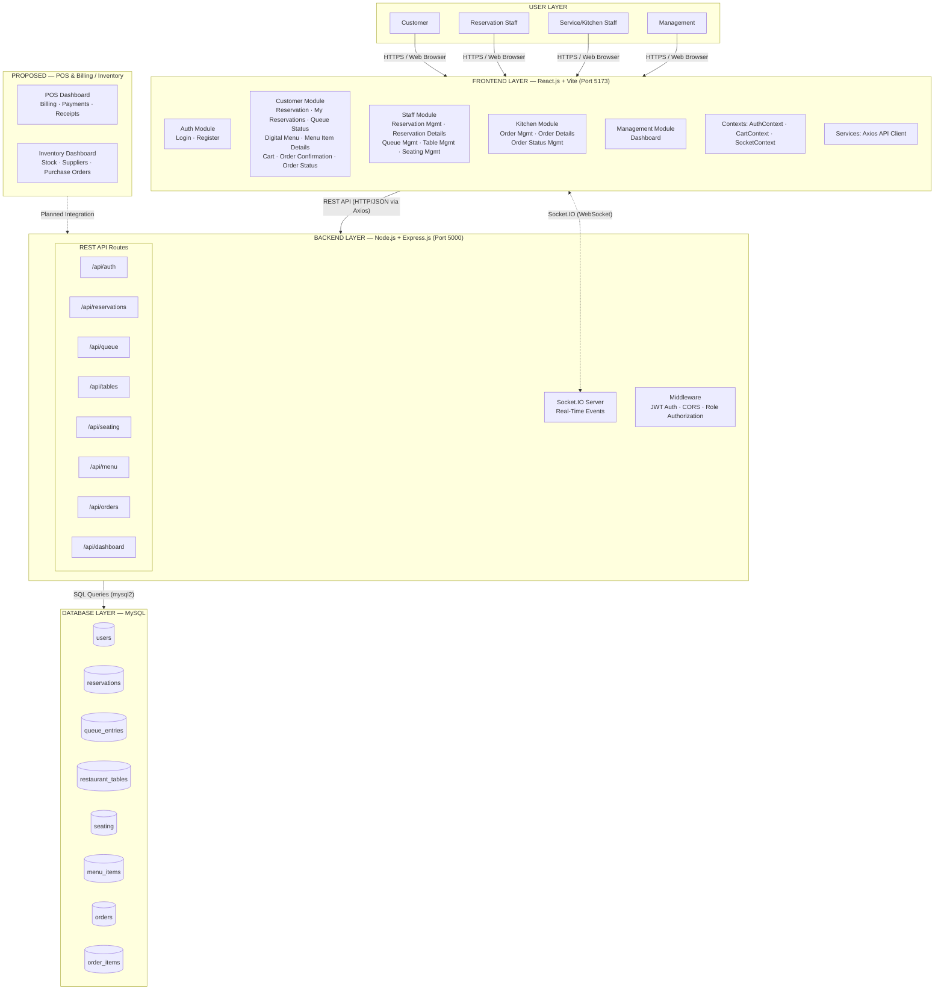

**Purpose:** Shows the complete layered architecture of VikingsERP — how users access the system through the React.js frontend, which communicates with the Node.js/Express.js backend via REST APIs and Socket.IO WebSocket, and how the backend persists data in MySQL.

**Application to VikingsERP:** The four user roles (Customer, Reservation Staff, Service/Kitchen Staff, Management) access role-specific React modules. The backend exposes 8 REST API route groups and a Socket.IO server for real-time updates. POS & Billing and Inventory & Procurement are identified as proposed future modules.

**Scenario:** A customer opens the web browser at `localhost:5173`, the React app loads, AuthContext checks JWT, Axios calls `/api/auth/me`, and Socket.IO establishes a WebSocket connection for live order status updates.

---

## Diagram 2: Class Diagram

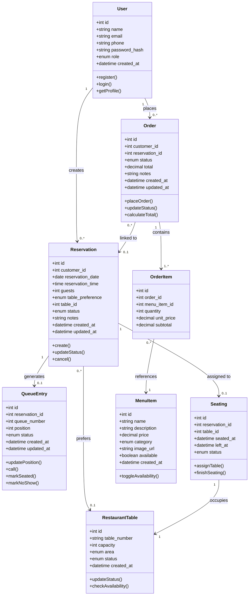

**Purpose:** Defines the system's core data entities, their attributes, methods, and relationships using standard UML class notation.

**Application to VikingsERP:** Eight classes map directly to the 8 MySQL tables. The diagram shows cardinality — a User creates multiple Reservations, each Reservation may generate one QueueEntry, and each Order contains multiple OrderItems referencing MenuItems.

**Scenario:** Customer John creates a Reservation (1-to-many). The staff approves it and a QueueEntry is generated (1-to-1). When seated, a Seating record links the Reservation to a RestaurantTable. John places an Order with 3 OrderItems referencing menu items.

---

## Diagram 3: Component Diagram

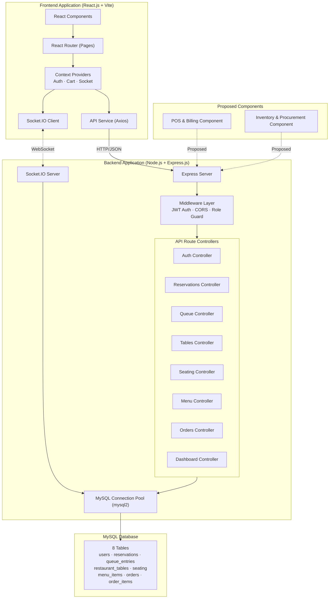

**Purpose:** Shows the major software components, their responsibilities, internal dependencies, and how they interact at the module level.

**Application to VikingsERP:** The frontend is composed of React Components, Router/Pages, Context Providers (Auth, Cart, Socket), and the Axios API service. The backend has Express Server, Middleware, 8 API Route Controllers, Socket.IO, and the MySQL connection pool. POS & Billing and Inventory & Procurement are shown as proposed components.

**Scenario:** When a customer places an order, the Cart Context feeds data to the API Service, which calls the Orders Controller via Express. The controller validates through Middleware, writes to MySQL via the connection pool, and emits a Socket.IO event to the kitchen.

---

## Diagram 4: Deployment Diagram

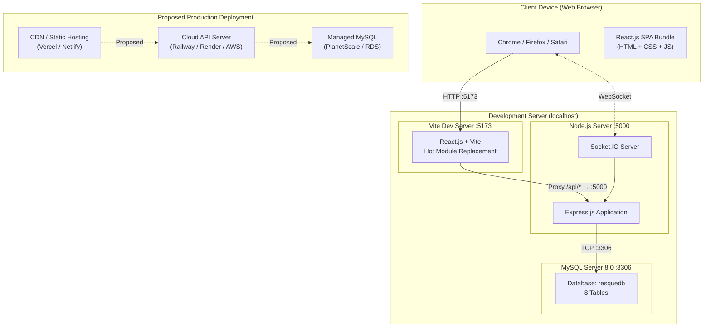

**Purpose:** Shows how VikingsERP software artifacts are deployed onto hardware/infrastructure nodes, distinguishing between verified development deployment and proposed production deployment.

**Application to VikingsERP:** Currently deployed locally — Vite dev server on port 5173 proxies API calls to Express on port 5000, which connects to MySQL 8.0 on port 3306. The proposed production deployment uses CDN hosting for the React SPA, a cloud API server for Express, and managed MySQL.

**Scenario:** Developer runs `npm run dev` in both `/frontend` and `/backend`. The browser loads React from Vite (:5173), API calls are proxied to Express (:5000), and MySQL serves data from the `resquedb` database on :3306.

---

## Diagram 5: Object Diagram

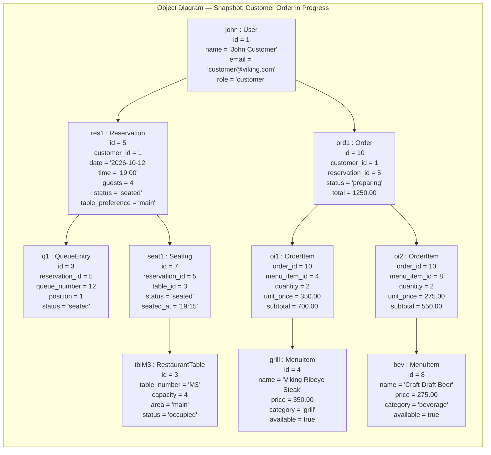

**Purpose:** Shows a concrete snapshot of actual object instances and their relationships at a specific moment in time, with illustrative sample attribute values.

**Application to VikingsERP:** Customer John has a seated reservation at Table M3, with an active order containing two items (Viking Ribeye Steak × 2 and Craft Draft Beer × 2) totaling ₱1,250.00. The order status is "preparing" in the kitchen.

**Scenario:** At 7:15 PM, John was seated at Table M3 after being called from queue position 1. He browsed the digital menu, added items to his cart, and confirmed an order that is now being prepared by the kitchen staff.

---

## Diagram 6: Package Diagram

```mermaid
graph TB
    subgraph Root["VikingsERP"]
        subgraph FE["frontend/"]
            subgraph FE_SRC["src/"]
                subgraph FE_COMP["components/"]
                    N1["Navbar.jsx"]
                    N2["ProtectedRoute.jsx"]
                end
                subgraph FE_CTX["context/"]
                    C1["AuthContext.jsx"]
                    C2["CartContext.jsx"]
                    C3["SocketContext.jsx"]
                end
                subgraph FE_PAGES["pages/"]
                    P0["Login.jsx\nRegister.jsx"]
                    subgraph P_CUST["customer/"]
                        PC1["Reservation.jsx"]
                        PC2["MyReservations.jsx"]
                        PC3["QueueStatus.jsx"]
                        PC4["DigitalMenu.jsx"]
                        PC5["MenuItemDetails.jsx"]
                        PC6["Cart.jsx"]
                        PC7["OrderConfirmation.jsx"]
                        PC8["OrderStatus.jsx"]
                    end
                    subgraph P_STAFF["staff/"]
                        PS1["ReservationManagement.jsx"]
                        PS2["ReservationDetails.jsx"]
                        PS3["QueueManagement.jsx"]
                        PS4["TableManagement.jsx"]
                        PS5["SeatingManagement.jsx"]
                    end
                    subgraph P_KITCHEN["kitchen/"]
                        PK1["OrderManagement.jsx"]
                        PK2["OrderDetails.jsx"]
                        PK3["OrderStatusManagement.jsx"]
                    end
                    subgraph P_MGMT["management/"]
                        PM1["Dashboard.jsx"]
                    end
                end
                subgraph FE_SVC["services/"]
                    S1["api.js"]
                end
                APP["App.jsx"]
                MAIN["main.jsx"]
                CSS["index.css"]
            end
            VCF["vite.config.js"]
            IDX["index.html"]
        end

        subgraph BE["backend/"]
            subgraph BE_CFG["config/"]
                DB1["db.js"]
            end
            subgraph BE_MW["middleware/"]
                MW1["auth.js"]
            end
            subgraph BE_ROUTES["routes/"]
                RR1["auth.js"]
                RR2["reservations.js"]
                RR3["queue.js"]
                RR4["tables.js"]
                RR5["seating.js"]
                RR6["menu.js"]
                RR7["orders.js"]
                RR8["dashboard.js"]
            end
            subgraph BE_SOCK["socket/"]
                SK1["index.js"]
            end
            subgraph BE_DB["database/"]
                SCH["schema.sql"]
            end
            SRV["server.js"]
            SEED["seed.js"]
            ENV[".env"]
        end
    end
```

**Purpose:** Shows the organizational structure of VikingsERP's source code packages, separating frontend and backend concerns with clear file groupings.

**Application to VikingsERP:** The frontend (`frontend/`) contains React components, context providers, 17 pages across 4 role-based directories, and the API service. The backend (`backend/`) contains Express configuration, JWT middleware, 8 API route modules, Socket.IO handler, and database files.

**Scenario:** A developer adding a new feature navigates to `frontend/src/pages/customer/` for customer-facing UI and `backend/routes/` for the corresponding API endpoint. The separation ensures frontend and backend can be developed independently.

---

## Diagram 7: Composite Structure Diagram

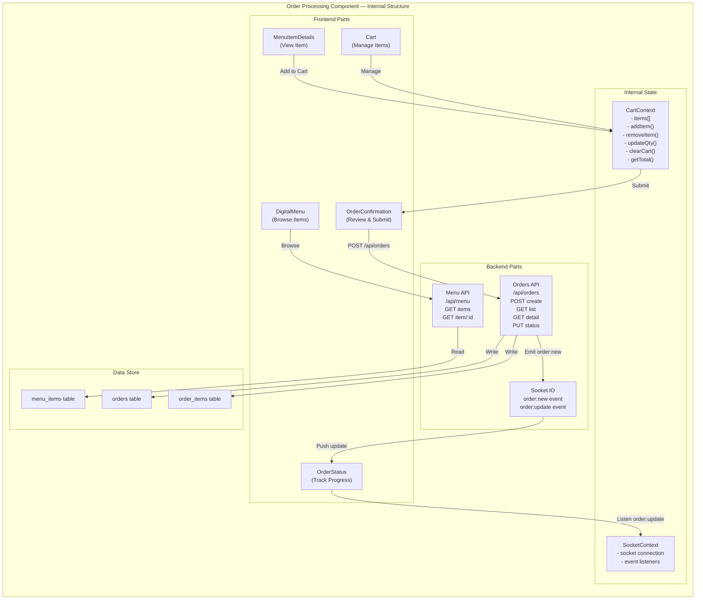

**Purpose:** Shows the internal structure of a major VikingsERP component — the Order Processing Component — including its internal parts, interfaces, and connections between frontend, backend, and data layers.

**Application to VikingsERP:** The Order Processing component spans from DigitalMenu browsing through Cart management, Order confirmation, backend order creation, and real-time status tracking. CartContext manages client-side state; Socket.IO pushes live updates to the OrderStatus page.

**Scenario:** Customer browses DigitalMenu → views MenuItemDetails → adds to Cart via CartContext → proceeds to OrderConfirmation → submits POST to Orders API → backend writes to orders and order_items tables → emits `order:new` via Socket.IO → kitchen receives live notification.

---

## Diagram 8: Profile Diagram

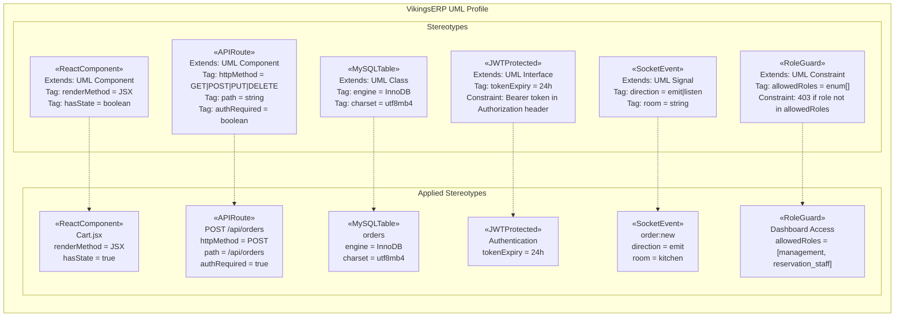

**Purpose:** Defines UML stereotypes, tagged values, and constraints specific to the VikingsERP system, extending standard UML metaclasses with domain-specific semantics.

**Application to VikingsERP:** Six stereotypes capture the system's key patterns: «ReactComponent» for frontend JSX components with state, «APIRoute» for Express.js endpoints with HTTP methods and auth requirements, «MySQLTable» for database entities, «JWTProtected» for token-based auth, «SocketEvent» for real-time events, and «RoleGuard» for role-based access constraints.

**Scenario:** When a developer defines a new API endpoint, they apply the «APIRoute» stereotype with tagged values for HTTP method, path, and auth requirement. The «RoleGuard» constraint ensures only authorized roles can access the endpoint.

---

# PART 2: BEHAVIORAL DIAGRAMS (The System in Motion)

---

## Diagram 9: Data Flow Diagram (DFD)

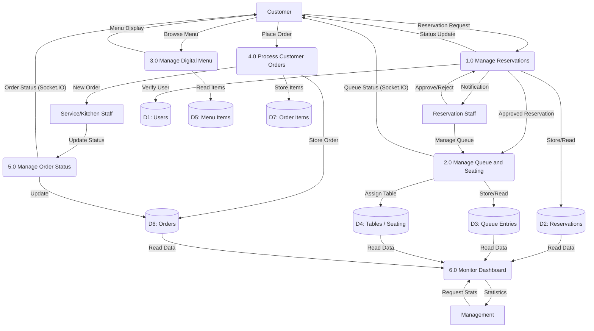

**Purpose:** Shows how information flows between external entities (users), system processes, and data stores using standard DFD notation.

**Application to VikingsERP:** Six major processes handle the flow of reservation requests, queue/seating management, menu browsing, order processing, order status updates, and dashboard monitoring. Socket.IO delivers real-time queue and order status updates.

**Scenario:** Customer submits a Reservation Request → Process 1.0 stores it in D2 and notifies Staff → Staff approves → Process 2.0 creates a queue entry in D3 → Customer receives Queue Status via Socket.IO → When seated, customer browses menu (Process 3.0) → Places order (Process 4.0) → Kitchen updates status (Process 5.0) → Customer receives live Order Status.

---

## Diagram 10: Use Case Diagram

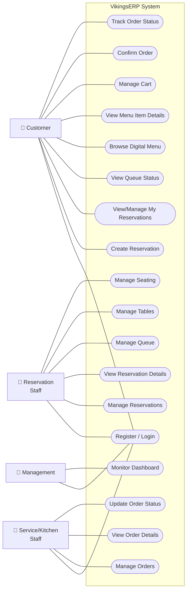

**Purpose:** Identifies all system actors and their authorized use cases within the VikingsERP system boundary.

**Application to VikingsERP:** Four actors — Customer (9 use cases), Reservation Staff (6), Service/Kitchen Staff (4), and Management (2). All actors share Register/Login. Role-based authorization restricts each actor to their permitted functions only.

**Scenario:** A Customer can create reservations, track queue status, browse the menu, manage their cart, and track orders. A Kitchen Staff member can only manage orders, view details, and update statuses. Management has exclusive dashboard access.

---

## Diagram 11: Activity Diagram

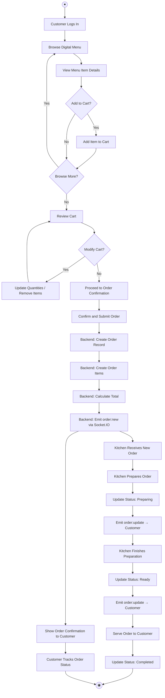

**Purpose:** Shows the complete step-by-step workflow of processing a customer order — from login through menu browsing, cart management, order confirmation, kitchen preparation, and status tracking.

**Application to VikingsERP:** The activity flows through the React frontend (menu browsing, cart, confirmation), Express backend (order creation, total calculation), Socket.IO (real-time notifications), and kitchen staff workflow (status updates).

**Scenario:** Customer logs in → browses menu → adds Viking Ribeye Steak and Craft Beer to cart → reviews cart → confirms order → backend creates order + items + calculates total → Socket.IO notifies kitchen → kitchen updates status to "preparing" → then "ready" → then "completed". Customer tracks live via OrderStatus page.

---

## Diagram 12: Sequence Diagram

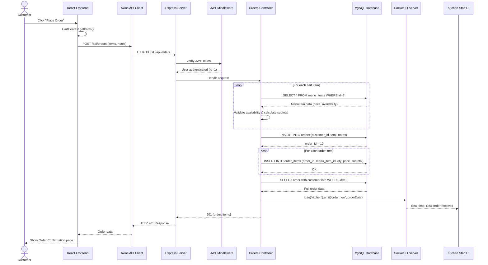

**Purpose:** Shows the chronological message interactions between system components during a customer order placement transaction.

**Application to VikingsERP:** Traces the exact code path from React → Axios → Express → JWT Middleware → Orders Controller → MySQL queries (menu validation, order INSERT, order_items INSERT) → Socket.IO notification → Kitchen UI update → Response back to customer.

**Scenario:** Customer clicks "Place Order" with 2 items in cart. The sequence shows JWT validation, menu item availability checks in a loop, order record creation, order items insertion, Socket.IO kitchen notification, and the 201 response with full order data.

---

## Diagram 13: State Machine Diagram

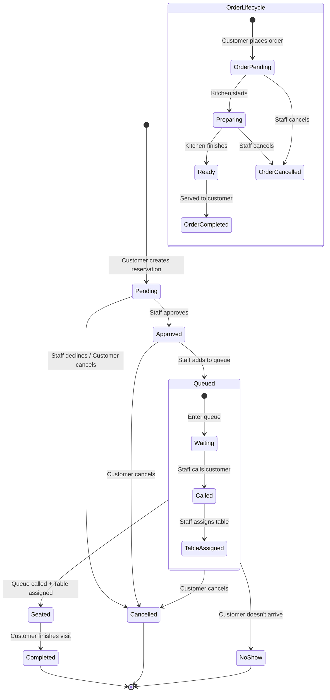

**Purpose:** Shows the lifecycle state transitions of two key system entities — Reservation and Order — including valid states, transition events, and conditions.

**Application to VikingsERP:** A Reservation progresses through Pending → Approved → Queued (with sub-states Waiting → Called → TableAssigned) → Seated → Completed. An Order follows OrderPending → Preparing → Ready → Completed. Both can be Cancelled at valid points.

**Scenario:** Reservation created (Pending) → Staff approves (Approved) → Added to queue (Queued/Waiting) → Staff calls customer (Called) → Table M3 assigned (Seated) → Customer finishes (Completed). Simultaneously, the order goes from Pending → Preparing → Ready → Completed.

---

## Diagram 14: Communication Diagram

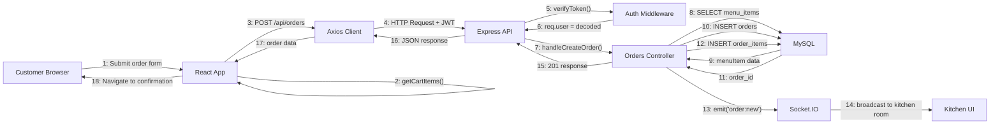

**Purpose:** Shows how objects and components communicate during a transaction, using numbered messages to represent the chronological order of interactions.

**Application to VikingsERP:** 18 numbered messages trace the complete communication path from the customer submitting an order form through React → Axios → Express → Auth → Orders Controller → MySQL (multiple queries) → Socket.IO → Kitchen UI → back to customer with confirmation.

**Scenario:** Messages 1-6 handle form submission and authentication. Messages 7-12 handle database operations (menu validation, order + items creation). Message 13-14 handle real-time kitchen notification. Messages 15-18 return the response to the customer.

---

## Diagram 15: Interaction Overview Diagram

```mermaid
graph TB
    START(("●")) --> REF1

    subgraph REF1["ref: Customer Authentication"]
        A1["Customer enters credentials"]
        A2["POST /api/auth/login"]
        A3["JWT token returned"]
        A4["Socket.IO connects with token"]
    end

    REF1 --> DECISION1{"Has Reservation?"}

    DECISION1 -->|"No"| REF2
    subgraph REF2["ref: Create Reservation"]
        B1["Fill reservation form"]
        B2["POST /api/reservations"]
        B3["Wait for approval"]
        B4["Queue entry created"]
        B5["Monitor queue via Socket.IO"]
        B6["Seated at table"]
    end

    DECISION1 -->|"Yes"| REF3

    REF2 --> REF3
    subgraph REF3["ref: Browse Menu and Order"]
        C1["GET /api/menu"]
        C2["Browse categories"]
        C3["Add items to CartContext"]
        C4["Review cart totals"]
    end

    REF3 --> REF4
    subgraph REF4["ref: Process Order"]
        D1["POST /api/orders"]
        D2["Validate menu items"]
        D3["Create order + order_items"]
        D4["Calculate total"]
        D5["Emit order:new"]
    end

    REF4 --> REF5
    subgraph REF5["ref: Kitchen Processing"]
        E1["Kitchen receives order"]
        E2["PUT /api/orders/:id/status → preparing"]
        E3["PUT /api/orders/:id/status → ready"]
        E4["Emit order:update"]
    end

    REF5 --> REF6
    subgraph REF6["ref: Order Completion"]
        F1["Customer sees Ready status"]
        F2["Order served"]
        F3["Status → completed"]
    end

    REF6 --> ENDNODE(("◉"))
```

**Purpose:** Provides a high-level overview of the entire order lifecycle by combining activity-style control flow with references to smaller interaction fragments.

**Application to VikingsERP:** Six interaction fragments cover the full business process: Customer Authentication → Create Reservation (optional) → Browse Menu and Order → Process Order → Kitchen Processing → Order Completion. A decision node handles whether the customer already has a reservation.

**Scenario:** Customer authenticates (REF1), creates reservation and waits in queue (REF2), browses menu and builds cart (REF3), submits order (REF4), kitchen prepares (REF5), order completed (REF6). Socket.IO provides real-time updates throughout REF2, REF5, and REF6.

---

## Diagram 16: Timing Diagram

```mermaid
gantt
    title VikingsERP Transaction Timing — Customer Order Lifecycle
    dateFormat HH:mm
    axisFormat %H:%M

    section Reservation
    Pending (Created)          :res1, 18:00, 15min
    Approved (Staff Action)    :res2, after res1, 10min
    Queued/Waiting             :res3, after res2, 20min
    Called                     :res4, after res3, 5min
    Seated                     :res5, after res4, 90min

    section Order
    Browsing Menu              :ord1, 18:50, 10min
    Cart Building              :ord2, after ord1, 5min
    Order Submitted (Pending)  :ord3, after ord2, 2min
    Preparing (Kitchen)        :ord4, after ord3, 20min
    Ready (Waiting Serve)      :ord5, after ord4, 5min
    Completed (Served)         :ord6, after ord5, 1min

    section Table M3
    Available                  :tbl1, 18:00, 50min
    Occupied (John seated)     :crit, tbl2, after tbl1, 90min

    section Socket.IO Events
    queue:update (position)    :sock1, 18:25, 1min
    queue:update (called)      :sock2, 18:45, 1min
    order:new (kitchen)        :sock3, 19:05, 1min
    order:update (preparing)   :sock4, 19:07, 1min
    order:update (ready)       :sock5, 19:27, 1min
```

**Purpose:** Shows how the states of system entities change over time during a transaction, with illustrative timing values representing a typical customer visit.

**Application to VikingsERP:** Four lanes track the parallel state changes of: Reservation (Pending → Approved → Queued → Called → Seated), Order (Browsing → Cart → Pending → Preparing → Ready → Completed), Table M3 (Available → Occupied), and Socket.IO events fired at key state transitions.

**Scenario (Illustrative Timing):** At 18:00 reservation created → 18:15 approved → 18:25 queued (Socket.IO position update) → 18:45 called (Socket.IO) → 18:50 seated, starts browsing → 19:05 order submitted (Socket.IO `order:new`) → 19:07 preparing (Socket.IO) → 19:27 ready (Socket.IO) → 19:32 completed. Total visit: ~90 minutes.

---

## Diagram 17: Requirement Diagram (SysML)

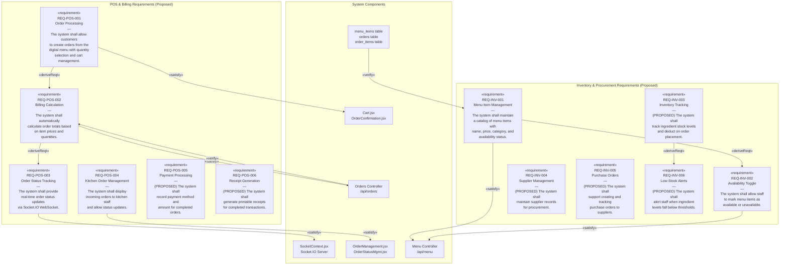

**Purpose:** Traces functional requirements for POS & Billing and Inventory & Procurement to their implementing system components using SysML requirement notation and relationships (satisfy, deriveReqt, verify).

**Application to VikingsERP:** Requirements REQ-POS-001 through REQ-POS-004 and REQ-INV-001 through REQ-INV-002 are satisfied by existing components (Cart, Orders Controller, Socket.IO, Kitchen pages, Menu Controller). Requirements REQ-POS-005/006 and REQ-INV-003 through REQ-INV-006 are clearly marked as PROPOSED.

**Scenario:** REQ-POS-001 (Order Processing) is satisfied by Cart.jsx and OrderConfirmation.jsx. It derives REQ-POS-002 (Billing Calculation), which is satisfied by the Orders Controller. REQ-POS-003 (Real-Time Tracking) is satisfied by SocketContext and the Socket.IO server. Proposed requirements (Payment, Receipts, Inventory, Suppliers, Purchase Orders, Alerts) identify future development needs.

---

## Diagram Legend

| Symbol | Meaning |
|--------|---------|
| Solid Rectangle | External Entity / Component / Class |
| Rounded Rectangle | Process / Activity |
| Cylinder | Database / Data Store |
| Ellipse/Stadium | Use Case |
| Stick Figure | Actor |
| Solid Arrow | Data Flow / Dependency / Association |
| Dashed Arrow | Proposed / Real-Time / Asynchronous |
| `«stereotype»` | UML Stereotype |
| (PROPOSED) | Not yet implemented in current codebase |

---

## Consistency Notes

- All 17 diagrams reference the same **4 actors**: Customer, Reservation Staff, Service/Kitchen Staff, Management
- All diagrams use the same **8 database tables**: users, reservations, queue_entries, restaurant_tables, seating, menu_items, orders, order_items
- All diagrams reference the same **8 API route groups**: auth, reservations, queue, tables, seating, menu, orders, dashboard
- **Socket.IO events** are consistently shown: `order:new`, `order:update`, `queue:update`, `reservation:update`
- **POS & Billing / Inventory & Procurement** proposed features are consistently marked as "(PROPOSED)" across all diagrams
- **Technology stack** is consistently labeled: React.js + Vite (frontend), Node.js + Express.js (backend), MySQL (database), Socket.IO (real-time)
