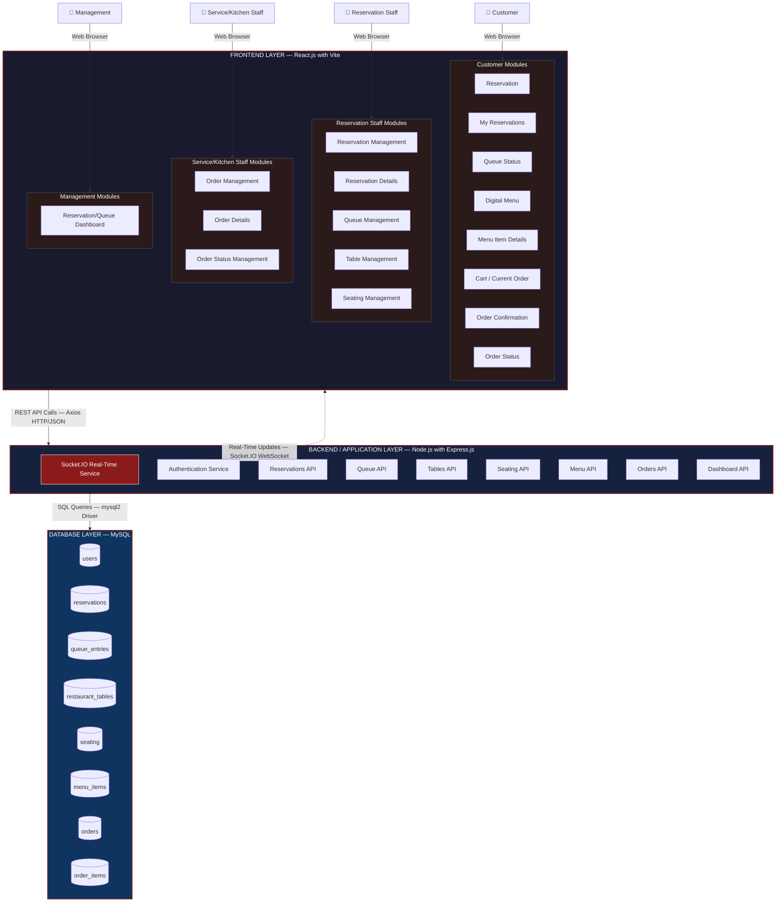
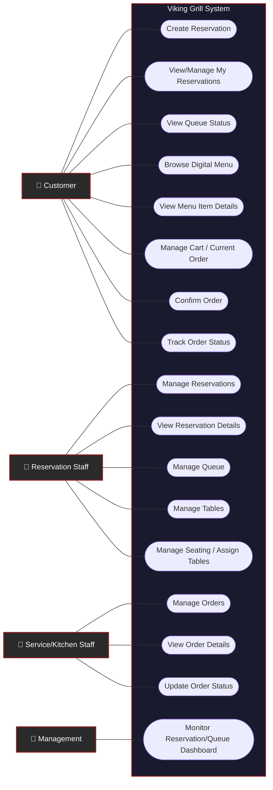
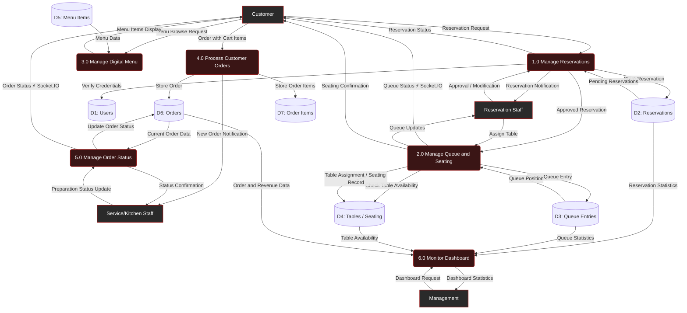

# Viking Grill — System Diagrams

> System diagrams for the Viking Grill Restaurant Reservation, Queue, Seating, Digital Menu, and Ordering System.
> Technology Stack: React.js + Vite | Node.js + Express.js | MySQL | Socket.IO

---

## 1. Viking Grill System Architecture Diagram

### Explanation

The **System Architecture Diagram** illustrates the layered structure of the Viking Grill system, organized into four tiers:

1. **User Layer** — Four actor types (Customer, Reservation Staff, Service/Kitchen Staff, Management) access the system through a web browser.

2. **Frontend Layer (React.js + Vite)** — Contains all user-facing modules grouped by role. Customer modules handle reservations, queue tracking, digital menu browsing, cart management, and order tracking. Staff modules handle reservation approvals, queue operations, table management, and seating assignments. Kitchen modules handle order processing and status updates. The Management module provides a centralized dashboard.

3. **Backend/Application Layer (Node.js + Express.js)** — Hosts all REST API services: Authentication, Reservations, Queue, Tables, Seating, Menu, Orders, and Dashboard. The Socket.IO Real-Time Service pushes live updates to connected frontend clients for queue position changes, order status updates, table status changes, and dashboard statistics.

4. **Database Layer (MySQL)** — Stores all persistent data across eight tables: `users`, `reservations`, `queue_entries`, `restaurant_tables`, `seating`, `menu_items`, `orders`, and `order_items`.

Communication between layers uses **REST API calls (HTTP/JSON via Axios)** for standard request-response operations, **Socket.IO (WebSocket)** for real-time bidirectional updates, and **SQL queries (via the mysql2 driver)** for database operations.

---

## 2. Viking Grill Use Case Diagram

### Explanation

The **Use Case Diagram** defines all functional interactions between the four primary actors and the Viking Grill system. Each use case corresponds to a specific feature implemented in the React.js frontend and backed by Node.js/Express.js REST API endpoints.

**Customer** (8 use cases):
- **Create Reservation** — Submit a reservation with date, time, guest count, and area preference.
- **View/Manage My Reservations** — View reservation history and cancel pending/approved reservations.
- **View Queue Status** — Track real-time queue position with Socket.IO live updates.
- **Browse Digital Menu** — View the restaurant's food and beverage catalog filtered by category.
- **View Menu Item Details** — See detailed information, pricing, and images for individual menu items.
- **Manage Cart/Current Order** — Add items, adjust quantities, and remove items before ordering.
- **Confirm Order** — Review the final order summary and submit it to the kitchen.
- **Track Order Status** — Monitor real-time order progress (Pending → Preparing → Ready → Completed).

**Reservation Staff** (5 use cases):
- **Manage Reservations** — View all reservations, approve or decline pending ones, and add to queue.
- **View Reservation Details** — Inspect and edit individual reservation records, customer info, and notes.
- **Manage Queue** — Call waiting customers, reorder queue positions, and mark no-shows.
- **Manage Tables** — View table grid by area, update availability status, and add/remove tables.
- **Manage Seating/Assign Tables** — Select a queued customer and assign them to an available table.

**Service/Kitchen Staff** (3 use cases):
- **Manage Orders** — View incoming orders with filters by status and take action on each order.
- **View Order Details** — See itemized order breakdown with quantities, prices, and special notes.
- **Update Order Status** — Advance orders through the preparation workflow and notify customers.

**Management** (1 use case):
- **Monitor Reservation/Queue Dashboard** — View aggregated real-time statistics for reservations, queue, tables, seating, orders, and revenue.

All use cases exist within a single **Viking Grill System** boundary, reflecting that the system is a unified web application.

---

## 3. Viking Grill Data Flow Diagram (DFD)

### Explanation

The **Data Flow Diagram (DFD)** traces how information moves through the Viking Grill system between four external entities, six processes, and seven data stores. Each labeled arrow represents a specific data flow.

**Reservation Flow:**
The Customer submits a **Reservation Request** to Process 1.0 (Manage Reservations), which verifies the user's credentials against the Users data store and writes the reservation to the Reservations data store. A **Reservation Notification** is sent to Reservation Staff, who can issue an **Approval or Modification**. The resulting **Reservation Status** is sent back to the Customer. Approved reservations flow into Process 2.0.

**Queue and Seating Flow:**
Process 2.0 (Manage Queue and Seating) creates a queue entry in the Queue Entries data store. The Customer receives real-time **Queue Status** updates via **Socket.IO**. Reservation Staff can view **Queue Updates** and **Assign Tables** by checking the Tables/Seating data store for availability. Once a table is assigned, the seating record is stored and a **Seating Confirmation** is sent to the Customer.

**Digital Menu Flow:**
The Customer sends a **Menu Browse Request** to Process 3.0 (Manage Digital Menu), which reads **Menu Data** from the Menu Items data store and returns the **Menu Items Display** to the Customer.

**Order Processing Flow:**
The Customer submits an **Order with Cart Items** to Process 4.0 (Process Customer Orders), which stores the order in the Orders data store and individual items in the Order Items data store. A **New Order Notification** is sent to Service/Kitchen Staff.

**Order Status Flow:**
Service/Kitchen Staff sends a **Preparation Status Update** to Process 5.0 (Manage Order Status), which updates the order status in the Orders data store. The Customer receives the **Order Status** update in real-time via **Socket.IO**, and the staff receives a **Status Confirmation**.

**Dashboard Flow:**
Management sends a **Dashboard Request** to Process 6.0 (Monitor Dashboard), which aggregates data from the Reservations, Queue Entries, Tables/Seating, and Orders data stores, and returns **Dashboard Statistics** including reservation counts, queue metrics, table availability, and revenue.

The **⚡ Socket.IO** annotation on data flows to the Customer indicates that these updates are delivered in real-time via WebSocket connections rather than standard HTTP polling, ensuring immediate visibility of queue position changes and order status transitions.

---

## Diagram Legend

| Symbol | Meaning |
|--------|---------|
| Rectangle | External Entity (Actor/User) |
| Rounded Rectangle | Process |
| Cylinder | Data Store |
| Stadium/Pill Shape | Use Case |
| Solid Arrow | Data Flow / Access |
| Dotted Arrow | Real-Time Update (Socket.IO) |
| ⚡ | Indicates Socket.IO real-time delivery |
| Subgraph Border | System Boundary / Layer Boundary |

---

## Consistency Notes

- All three diagrams reference the **same four actors**: Customer, Reservation Staff, Service/Kitchen Staff, and Management.
- All frontend modules listed in the Architecture Diagram correspond to use cases in the Use Case Diagram.
- All backend API services in the Architecture Diagram correspond to processes in the Data Flow Diagram.
- All database tables in the Architecture Diagram correspond to data stores in the Data Flow Diagram.
- Socket.IO real-time communication is consistently shown across all three diagrams for queue status and order status updates.
- The terminology (module names, process names, data store names) is consistent across all diagrams.
